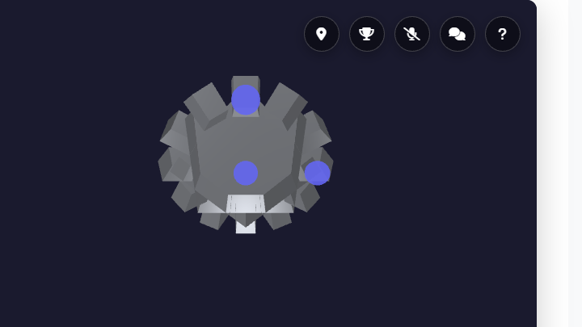
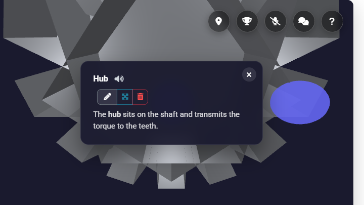
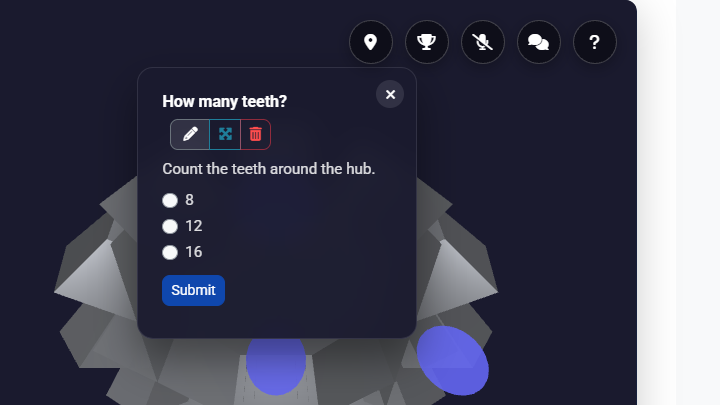
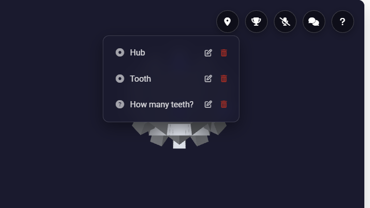
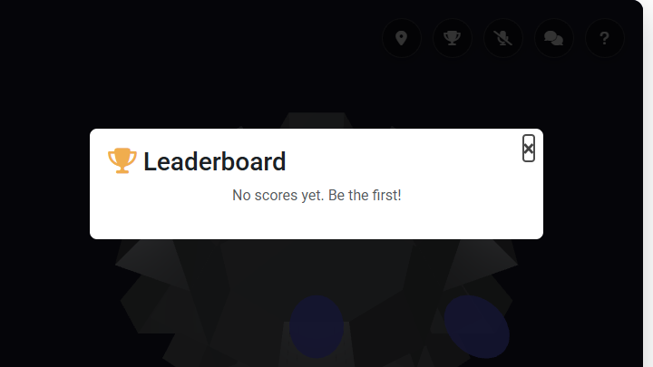
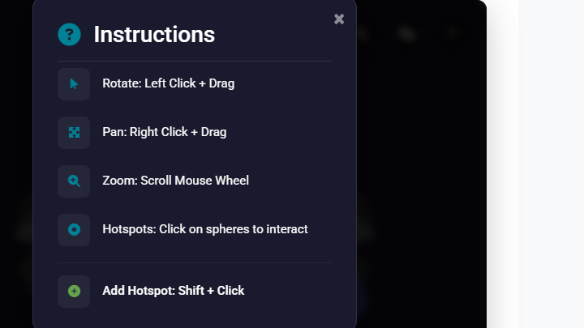
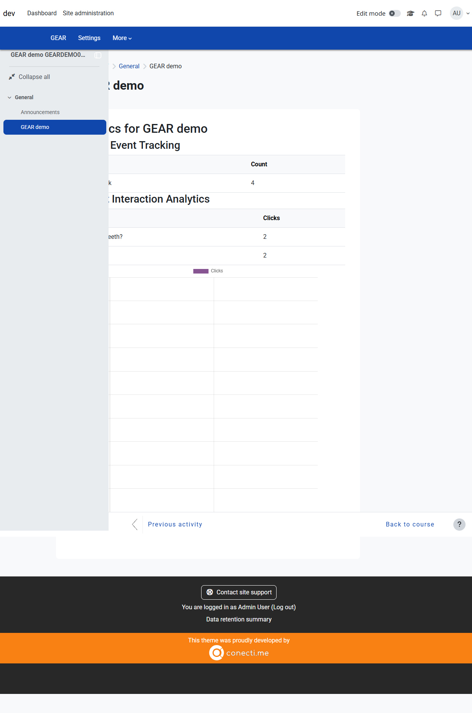

# GEAR - Immersive AR/VR Learning for Moodle

[](https://github.com/blagojevicboban/moodle-mod_gear/actions/workflows/ci.yml)
[](https://moodle.org)
[](https://php.net)
[](LICENSE)

**GEAR** (Geospatial Educational Augmented Reality) is a Moodle activity module that enables immersive AR/VR learning experiences with 3D models, hotspots, and WebXR support.

## ✨ Features

| Feature | Description |
|---------|-------------|
| 🎮 **3D Viewer** | Display glTF/GLB models with orbit controls |
| 📱 **AR Mode** | View 3D content in augmented reality |
| 🥽 **VR Mode** | Immersive WebXR experience with interactive hand controllers |
| 📍 **Hotspots** | Interactive information points (Info, Quiz, Audio, Video, Teleport) |
| 💬 **Tooltips** | Hover tooltips with icons, titles, and descriptions for quick context |
| ♿ **Accessibility** | Keyboard navigation, screen reader labels, and touch/long-press for mobile |
| 🎞️ **Video** | Embed MP4s, YouTube, or Vimeo directly in 3D scenes |
| 🧩 **Gamification** | Branching scenarios & escape-room style conditional unlocking |
| ✨ **AI Assist** | Generate hotspot content and quizzes with the AI providers of Moodle (core AI subsystem) |
| 🗣️ **Text-to-Speech**| Native auto-narration of informational hotspots |
| 📝 **Quizzes** | In-world multiple choice questions with grading |
| 👥 **Collaborative** | Real-time multi-user sessions with avatars |
| 💬 **P2P Chat** | Real-time Peer-to-Peer WebRTC spatial voice and text chat |
| 🏆 **Leaderboards** | Gamification with top score display, group-aware |
| ✅ **Completion** | Complete by opening every hotspot and/or earning a minimum of quiz points |
| 🔊 **Spatial Audio** | Positional audio guides that react to distance |
| 📊 **Analytics** | Teacher dashboard displaying hotspot click charts and event tracking |
| 🌐 **WebXR** | No app installation required |
| ⚡ **Performance** | Optimized WebGL & WebXR scaling for mobile devices |
| 🔒 **Privacy** | Implements Moodle Privacy API (metadata, export, deletion) |
| 📦 **Backup** | Full Backup/Restore support |
| 📱 **Mobile** | Moodle Mobile App support |

## 🖼️ Screenshots

| | |
|---|---|
|  |  |
|  |  |
|  |  |



## 📋 Requirements

- **Moodle**: 4.5 LTS to 5.3+
- **PHP**: 8.2+
- **Database**: MySQL, MariaDB, or PostgreSQL
- **Browser**: Chrome, Firefox, Safari, Edge (WebGL support)
- **AR/VR**: WebXR-compatible browser (see the note on iPhone/iPad below)
- **AI provider**: Optional, required only for the AI Assistant (Site administration → General → AI)

## 🚀 Installation

### Via Git
```bash
cd /path/to/moodle/mod
git clone https://github.com/blagojevicboban/moodle-mod_gear.git gear
php admin/cli/upgrade.php
```

### Via Download
1. Download the [latest release](https://github.com/blagojevicboban/moodle-mod_gear/releases)
2. Extract to `/mod/gear/`
3. Visit Site Administration → Notifications

## 📖 Usage

Step-by-step guides: [teacher guide](docs/teacher-guide.md) and [student guide](docs/student-guide.md).

### For Teachers

1. **Activity Setup**:
   - Add activity → **GEAR**.
   - Upload a **3D model** (`.glb` or `.gltf` with companion `.bin` and texture image files).
2. **Interactive Scene**:
   - Open the activity and click the **Edit** (pencil) icon.
   - **Shift + Click** anywhere on the 3D model to add a hotspot.
   - Use the **Visual Authoring Gizmo** (3D Arrows) to position hotspots along the X, Y, and Z axes.
3. **Scene Configuration**:
   - Adjust the camera to your preferred starting position and zoom level.
   - Click **Save Current View (Set as default)** to save the initial state for all students.
4. **Hotspot Types**:
   - **Info**: Rich text description.
   - **Quiz**: Multiple choice questions with automated grading.
   - **Audio**: Positional audio (`.mp3`/`.wav` URL).
   - **Video**: Embed videos (MP4, YouTube, Vimeo URL).
   - **Teleport**: Seamlessly fly the camera to new locations.
5. **Branching Scenarios**:
   - Set a **"Requires Quiz (Unlock)"** condition on any hotspot to hide it until a student correctly answers a specific 3D quiz.
6. **✨ AI Assistant**:
   - In the Hotspot editor, enter a short prompt and click **AI Assist**.
   - For **Quizzes**, the AI will automatically generate options and select the correct answer.

### For Students

1. **Exploration**: Rotate, zoom, and move around the 3D model.
2. **Interaction**: Click hotspots to view info, take quizzes, or listen to audio guides.
3. **Accessibility**:
   - Use **Tab** to focus the 3D viewer, then **Arrow keys** to navigate between hotspots and **Enter** to activate them.
   - Use the Text-to-Speech button on info hotspots to have the content read aloud.
   - On mobile, **long-press** (0.5s) on a hotspot to view its tooltip.
4. **Collaboration**: See other students in the same scene as 3D avatars. Connect via microphone for real-time WebRTC 3D voice chat.
5. **Spatial Audio**: Move closer to audio hotspots or other speaking students to hear them louder. Use headphones for the best experience.

## ⚙️ Configuration

To use the **AI Assistant**:
1. Configure an AI provider that supports text generation in **Site Administration → General → AI → AI providers** (for example OpenAI, Azure, Gemini or Ollama).
2. Go to **Site Administration → Plugins → Activity Modules → GEAR** and enable **Enable AI Assistant**.
3. Teachers see the **AI Assist** button in the hotspot editor. Each user accepts Moodle's AI usage policy the first time.

Models, quotas and logging are managed by Moodle (*AI → Usage report*).

## 🔒 Privacy and data

GEAR stores quiz results, hotspot clicks and (while a session is open) camera positions in the Moodle database; all of it is covered by the Moodle Privacy API (export and deletion).

| Feature | Data that leaves your Moodle site | Where it goes |
|---------|-----------------------------------|---------------|
| **AI Assistant** (optional, off by default) | The prompt/topic text a teacher types | The AI provider that the administrator configured in Moodle's AI settings (users accept the Moodle AI usage policy first) |
| **Collaborative mode, voice and chat** (optional, off for new installs) | A random peer id and IP address (to the PeerJS broker); chat messages and audio go directly between the browsers of the participants | The public PeerJS cloud, or your own PeerJS server (setting *PeerJS server URL*) |

Models, hotspots, grades and analytics never leave your site. Keep the AI Assistant and collaborative mode switched off in the plugin settings if you do not want any external service.

## 📱 Browser notes

- **Desktop and Android (Chrome, Edge, Firefox):** 3D viewer, WebXR VR and AR where the device supports it.
- **iPhone and iPad (Safari):** the 3D viewer works, but WebXR augmented reality is not available; AR is possible through Apple's AR Quick Look when you upload a `.usdz` file with the same name as the model (GEAR does not convert models).
- **Apple Vision Pro:** WebXR immersive VR is available in Safari on visionOS (may need to be enabled).

## 🎨 Supported Formats

| Format | Extension | Description |
|--------|-----------|-------------|
| GLB | `.glb` | Binary glTF single file (recommended); Draco and Meshopt compression are supported |
| USDZ | `.usdz` | Optional companion with the same name as the model (`engine.glb` + `engine.usdz`) for AR Quick Look on iPhone and iPad |
| glTF | `.gltf` + `.bin` + images | JSON glTF with companion binary/texture assets |

## 🛠️ Development

```bash
# Clone repository
git clone https://github.com/blagojevicboban/moodle-mod_gear.git gear

# Install dependencies
npm install

# Build & Minify JS
npx grunt amd

# Run PHPUnit tests (from the Moodle root after phpunit init)
vendor/bin/phpunit mod/gear/tests/
```

## 📁 Structure

```
mod/gear/
├── amd/              # JavaScript source (viewer, sync, dom) and the bundled AMD build
├── backup/           # Backup/restore handlers
├── classes/          # PHP classes (events, external, privacy, task)
├── db/               # Database schema, capabilities, services, tasks
├── docs/             # Teacher and student guides, screenshots
├── lang/             # Language files (en, sr)
├── pix/              # Icons
├── templates/        # Mustache templates
├── tests/            # PHPUnit & Behat tests
├── vendorjs/         # Self-hosted PeerJS library
├── lib.php           # Core Moodle module callbacks
├── mod_form.php      # Activity settings form
├── report.php        # Analytics report page
├── settings.php      # Admin settings
├── styles.css        # Module stylesheet
├── thirdpartylibs.xml# Third-party library metadata
├── view.php          # Main activity view
└── version.php       # Plugin metadata
```

## 🌍 Languages

- 🇬🇧 English
- 🇷🇸 Srpski (Serbian)

## 🤝 Contributing

See [CONTRIBUTING.md](CONTRIBUTING.md) for guidelines.

## 📄 License

GNU GPL v3 or later - see [LICENSE](LICENSE)

## 👤 Author

**Boban Blagojević**  
[GitHub](https://github.com/blagojevicboban)

## 🙏 Credits

- [Three.js](https://threejs.org/) - 3D library (MIT)
- [PeerJS](https://peerjs.com/) - WebRTC wrapper (MIT)
- [WebXR](https://immersiveweb.dev/) - AR/VR API
